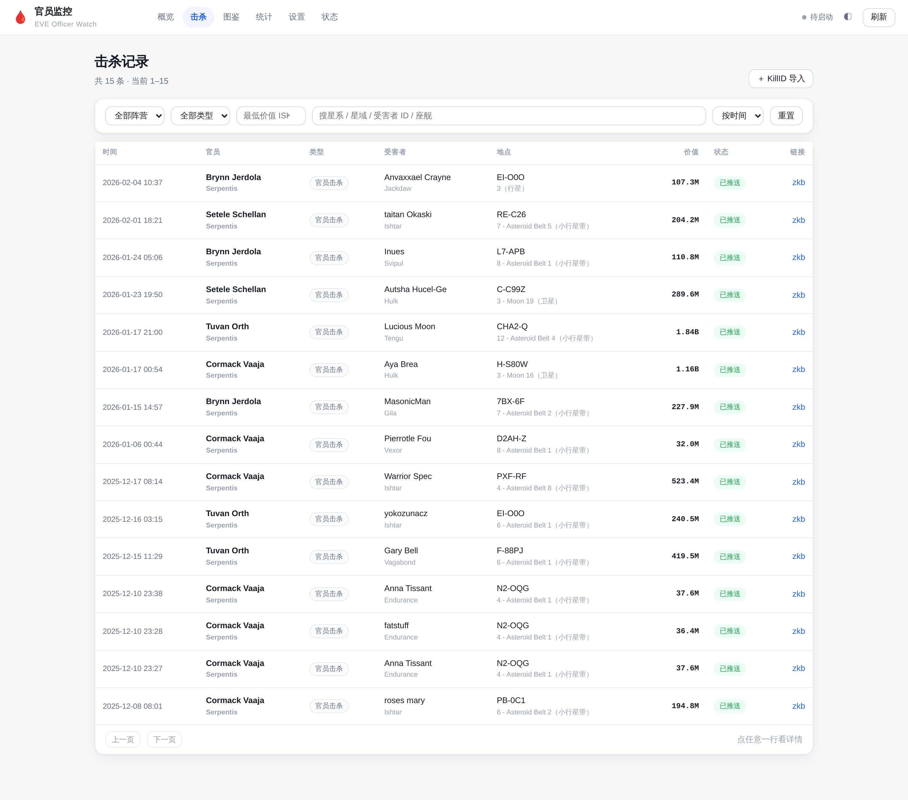
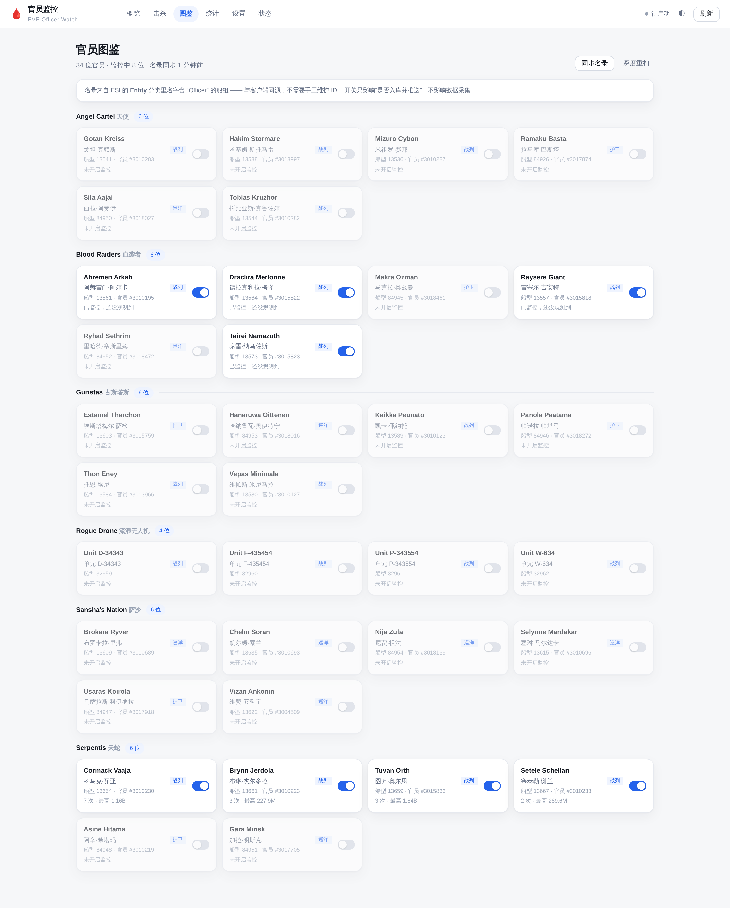

# officerwatch · EVE 官员击杀监控

[](https://github.com/724686158/officerwatch/actions/workflows/ci.yml)
[](LICENSE)

全服官员击杀雷达。盯住"谁被官员打死了 / 谁把官员打死了"，入库、算价值、按口径推邮件。





这是老项目 **EVE-RedisQ**（2025-11 ~ 2026-02，Windows 单 exe、1700 行 `gui_http.go` 内嵌 HTML）
的现代化重写：同样的产品判断，重做的工程结构。作者自托管实例挂在某个子路径下（`/officerwatch/`），
你也可以直接 `go build` 跑在自己机器上。

```
             ┌──────────────────────────────────────────────┐
  R2Z2 序列流 │  source/r2z2  ──┐                           │
  (全服无损)  │                 ├─→ collect ─→ store(SQLite) │
  zkb 轮询    │  source/zkb   ──┘        │                  │
  (兜底)      │                          ↓                  │
             │                    notify ─→ 邮件 / Webhook / OneBot
             └──────────────────────────────────────────────┘
                                  ↓
                        web (JSON API + 内嵌单页)
```

## 它解决什么

EVE 里的"官员"（Officer）是极稀有的 NPC 怪，打死它会掉官员装备（单件几百 M ~ 上 B ISK）。
反过来，官员主动打死玩家时，说明那个星系里刷了官员 —— 这是少数能实时观测到的信号。

前身盯的是后者（玩家被官员打死），新版本两者都支持：

| 角色 | 含义 | 典型价值 |
|---|---|---|
| `npc_kill` | 官员打死了玩家（默认口径） | 几十 M ~ 2B |
| `officer_down` | 玩家打死了官员 | 官员装备掉落，通常更高 |

## 数据源：为什么不用 RedisQ 了

前身用 `zkillredisq.stream` 长轮询。两个硬伤：

1. **会漏**。长轮询每次只给一条，按 5.5 秒一条的全服节奏，客户端只能抽样；
2. **在这台机器上根本连不通**。实测 `curl https://zkillredisq.stream/...` 返回
   `SSL routines::wrong version number`（TLS 被重置），换 UA/重试都没用。

现在的主源是 zKillboard 的 **R2Z2 序列流**（[文档](https://github.com/zKillboard/zKillboard/wiki/API-(R2Z2))）：

- `GET https://r2z2.zkillboard.com/ephemeral/sequence.json` 拿当前序列号；
- `GET .../ephemeral/{seq}.json` 拿那一条（含完整 ESI killmail + zkb 价值）；
- 序列号单调递增、文件保留 24 小时 → **断点续传、不丢**；404 就睡 6 秒（官方建议）；
- 限流 15 req/s，本程序按 10 req/s 走（每条 sleep 100ms）；
- **必须带非空 User-Agent**，否则 Cloudflare 直接 403。

兜底：`source: "zkb"` 走 `/api/kills/shipTypeID/{id}/`，只轮询开着的官员船型
（接口有 1 小时缓存，10 分钟轮一次）。适合只关心几个官员、想省流量的场景。

## 官员名录：不手抄 ID 表

名录来自 ESI 的 **Entity 分类（category_id = 11）**里名字含 `Officer` 的船组，例如
`Asteroid Serpentis Officer` 恰好 4 条船：Cormack Vaaja / Tuvan Orth / Brynn Jerdola / Setele Schellan。
与客户端同源，CCP 加新官员时同步一遍就能跟上。

当前快照：**16 个船组 / 34 位官员 / 6 个阵营**（Angel Cartel 天使、Blood Raiders 血袭者、
Guristas 古斯塔斯、Rogue Drone 流浪无人机、Sansha's Nation 萨沙、Serpentis 天蛇）。

每个阵营的结构基本一致：**4 条战列级 + 1 条巡洋级 + 1 条护卫级**（Rogue Drone 只有 4 条战列级，
Guristas 的 Estamel Tharchon 按船体质量算护卫级）。

**两套 ID 别混**：

| | 例子 | 用在哪 |
|---|---|---|
| 船型 ID（typeID） | `13654` | killmail 里 NPC 攻击者只有这个；匹配、开关、入库都以它为准 |
| NPC 角色 ID | `3010230` | 官员"本人"，只用于展示与查资料；killmail 里没有这个字段 |

中文译名（`科马克·瓦亚`）、吨位、角色 ID 存在 `internal/catalog/data/officers.json`，
由 `tools/build-officer-meta.py` 生成、`tools/verify-officer-meta.py` 校验与 ESI 的一致性。
**译名是音译，不是 CCP 官方译法**——官方中文客户端没有公开这层对照表。

- 常规同步：只拉已知 16 个船组（约 50 次 ESI 请求，几十秒），启动时 + 每 24 小时；
- 深度重扫：扫完 Entity 分类下 415 个组找新船组（页面「图鉴 → 深度重扫」）；
- **开关只控制"是否入库并推送"**，不影响发现；同步名录**不会**覆盖用户关掉的开关。

判定官员看的是 `character_id == 0`（NPC 没有角色 ID）**且**船型在名录里 —— 只认船型会被
未来任何撞 ID 的东西骗到。

## 功能

- **概览**：今日/7 天/累计、今日损失、单笔最大、14 天柱图、阵营分布、最近入库
- **击杀**：按阵营/角色/最低价值/关键字筛选，按时间或价值排序，分页，点开看详情（含原始 JSON）
- **图鉴**：34 位官员按阵营分组，一键开关。每位标出**中文译名、吨位（战列/巡洋/护卫）、
  船型 ID、NPC 角色 ID**，以及观测次数/最高价值/最近一次
- **统计**：30 天曲线、击杀最多的官员 Top 10、阵营累计
- **设置**：口径（角色、价值阈值、阵营白名单）、静默时段、每小时限流、通知总开关、回填小时数、
  家星系（算跳数）、**收件人管理**（加/删，立即生效）
- **状态**：采集游标、命中/入库/推送计数、错误、库大小、名录同步时间、事件流
- **位置情报**：死亡星体（带/异常/站/门）+ 安全等级 + 距家跳数
- **手工操作**：KillID 导入（zkb 拿 hash → ESI 拿详情 → 同一条入库/通知路径）、重发通知、发测试消息
- **历史补全**：`-enrich` 一次补齐星系/安全等级/受害者身份/价值构成（幂等）

## 通知

| 通道 | 状态 | 说明 |
|---|---|---|
| **邮件** | 主通道 | SMTP + STARTTLS（QQ 邮箱 587 + 授权码），HTML + 纯文本双份。**收件人在页面「设置 → 收件人」里增删**（最多 20 个，可一次粘贴多个），留空才回退到 `config.json` 的 `smtp.to` |
| Webhook | 可选 | JSON POST，带 `X-Officerwatch-Secret`，可接 ntfy / 飞书 / 钉钉网关 |
| OneBot | 可选 | QQ 群。**当前不具备条件**（依赖自建/朋友的机器人服务端），留空即不启用 |

### 死亡位置：精确到"哪条带"

这套东西的用途是**抢官员**：官员把玩家打死后，死亡点就是官员所在的位置。所以只给星系不够，
要精确到星体。实现分两步：

1. **星体名索引**（`internal/locs`）：把 SDE 的 `mapDenormalize` 裁成
   `(星体ID, 星系ID, 组, 名字)` 四列打包进二进制（2.4 MB gzip，47 万行），
   首次启动灌进 SQLite 的 `celestials` 表（约 15 秒，一次性）。
   为什么不用在线接口：zkillboard 只给 `locationID`，而 ESI 的 `/universe/names`
   **解析不了星体 ID**（实测报 `Ensure all IDs are valid`）。
2. **跳数**：设置里填"家星系"（如 `Jita`），通知时会用 ESI 的
   `/route/{from}/{to}/?flag=shortest` 算最短跳数，邮件里直接写"距 Jita 32 跳"。

产物长这样：

```
地点：CHA2-Q · Fountain · 安全 -0.85
星体：12 - Asteroid Belt 4（小行星带）
距离：距 Jita 32 跳
```

月/行星/空间站/星门也在索引里（`（卫星）`/`（空间站）`），所以"死在哪"不会含糊。

### 邮件正文必须"不点链接也能看懂"

2026-11 反馈：很多人打不开 zKillboard（国内直连不稳、要 JS、要登录）。所以正文里直接给出：

```
🩸 官员击杀 · Tuvan Orth（Serpentis）

受害者：Lucious Moon（modro）
座舰：Tengu
价值：1.84B ISK（掉落 486.9M / 损毁 1.35B）
地点：CHA2-Q · Fountain · 安全 -0.85
时间：2026-01-17 21:00（北京时间）
战况：solo（1v1） · 1 点
参考：该官员历史最高损失（共 3 次）

https://zkillboard.com/kill/132697987/
（链接打不开可以忽略，上面的信息已经够了）
```

为此采集时会额外解析：受害者角色名 / 公司 / 联盟（ESI 公共只读接口，带缓存）、
星系安全等级、以及这条损失在该官员历史上的排名。全部走 `name_cache`，
同一个受害者/星系只查一次。

推送口径（全部页面可改，立即生效）：

```
角色口径 → 阵营白名单 → 最低价值 → 静默时段 → 每小时限流 → @全体（仅 OneBot）
```

被拦下的击杀仍会入库，状态记 `filtered` 并写明原因 —— 前身是直接丢掉的，事后没法解释"为什么没报"。

## 部署

推荐形态：**服务只监听 `127.0.0.1`，由 Nginx 反代到子路径，鉴权交给 Nginx**。
这样应用本身不用管证书和口令，端口也不用对公网开。

| 项 | 建议值 |
|---|---|
| 程序目录 | `/opt/officerwatch`（或 `~/apps/officerwatch`） |
| 二进制 | `bin/officerwatch`（CGO-free，约 12 MB，含星体索引） |
| 数据 | `data/officerwatch.db`（SQLite WAL，备份 = 复制这个目录） |
| 配置 | `config.json`（**权限必须 0600**，凭据只在这里） |
| 服务 | `deploy/officerwatch.service`（`Restart=always`、`ProtectSystem=strict`、`MemoryMax=512M`） |
| 端口 | 默认 `127.0.0.1:8795`，被占就改 `config.json` 的 `listen` |
| 反代 | `deploy/nginx-officerwatch.conf`（示例是按子路径 `/officerwatch/` 写的） |

一键发布（对象是一台你能 ssh 的 Linux 机器）：

```bash
DEPLOY_HOST=your.host DEPLOY_USER=you ./deploy/deploy.sh
```

它做四件事：交叉编译、上传、渲染并安装 systemd unit + Nginx 片段、重启后自测 `/healthz`。
`APP_DIR`（默认 `/opt/officerwatch`）和 `APP_USER` 也可以覆盖。

> ⚠️ 别把 `config.json` 提交进仓库：它里面有 SMTP 授权码。仓库里的 `.gitignore` 已经挡住它，
> 只留 `config.example.json` 作为模板。

## 本地开发

```bash
go build -o /tmp/ow ./cmd/officerwatch
cd /tmp/owdev && /tmp/ow -listen 127.0.0.1:8795      # 首次会自动同步名录 + 从当前序列开始
go test ./...                                        # 单测：匹配/口径/幂等/名录/文案
```

## 数据迁移

前身 `killmails.db` 的 15 条历史记录（2025-12-08 ~ 2026-02-04，合计 5.47B ISK）已迁入：

```bash
./bin/officerwatch -config ./config.json -import-legacy /tmp/legacy-killmails.db
```

老库只有 `kill_id / total_value / victim_id`，缺星系、座舰、受害者名、价值构成。
补全用一条命令（幂等，只补空字段）：

```bash
sudo systemctl stop officerwatch
./bin/officerwatch -config ./config.json -enrich
sudo systemctl start officerwatch
```

它会做三件事：ESI 查星系+星域+安全等级、ESI 查受害者角色/公司/联盟名、
zkb 补掉落/损毁拆分。15 条历史全量补完约 20 秒。

## 配置说明

见 `config.example.json`。要点：

- `source`：`r2z2`（默认）/ `zkb` / `both`；
- `smtp`：`host/port/user/pass/to`，`to` 支持逗号分隔多个；
- `userAgent`：**别留空**，R2Z2 会 403；
- 页面上的设置存在 SQLite 的 `meta.settings`，与 `config.json` 的凭据互不干扰。

## 运维速查

```bash
systemctl status officerwatch
journalctl -u officerwatch -f
curl -s 127.0.0.1:8795/healthz
sqlite3 ~/apps/officerwatch/data/officerwatch.db 'select count(*), round(sum(total_value)/1e9,2) from kills'
sudo site-backup                 # 备份已含 ~/apps（含本库）
```

## 隐私与安全

- **仓库里没有任何凭据**：SMTP 授权码、OneBot token、webhook secret 都只在服务器上的
  `config.json`（0600）；`.gitignore` 挡住 `config.json`、`data/`、`*.db`，只留
  `config.example.json` 作模板。
- **页面不接触明文凭据**：API 只回"已配置/未配置"和掩码后的发件人；收件人列表是业务数据，
  存在 SQLite 的 `settings` 里，不进仓库。
- **服务默认只听 127.0.0.1**，鉴权交给 Nginx；不要把它直接暴露到公网端口。
- 截图里的角色名/公司名来自 zKillboard 的公开击杀记录。
- 提交历史用 GitHub 的 noreply 邮箱（`git config user.email` 已设为
  `<id>+<user>@users.noreply.github.com`），不泄露真实邮箱。

## 数据来源与许可

代码 MIT（见 [LICENSE](LICENSE)）。打包的星体名索引派生自 CCP 的 EVE SDE，
来源与再生成方式写在 [NOTICE](NOTICE)；EVE Online 及其数据归 CCP hf 所有，
本项目是非官方社区工具。运行时只读消费 zKillboard 与 ESI 的公开接口。

## 目录

```
cmd/officerwatch       入口：配置、名录、采集循环、HTTP、优雅退出
internal/config        配置文件（凭据，0600）
internal/model         ESI / R2Z2 / 内部共用的结构体
internal/store         SQLite：schema、幂等写入、统计、设置、事件
internal/esi           ESI 客户端 + 名称缓存（星系/星域/船型）
internal/catalog       官员名录同步（常规 + 深度重扫）
internal/source        R2Z2 序列流、zkb 轮询
internal/collect       匹配 → 入库 → 口径判断 → 通知
internal/notify        邮件 / Webhook / OneBot 通道 + 文案
internal/legacy        老库迁移
internal/web           JSON API + go:embed 内嵌前端
internal/web/assets    纯静态前端（无构建步骤）
deploy                 systemd unit（模板）、Nginx 片段（模板）、发布脚本
tools/build-celestials.sh  重建星体名索引
tools/build-officer-meta.py  重建官员元数据（中文名/吨位/角色 ID）
tools/verify-officer-meta.py 校验官员元数据与 ESI 的一致性
docs/HISTORY.md        从 EVE-RedisQ 到这里的改造记录
```
